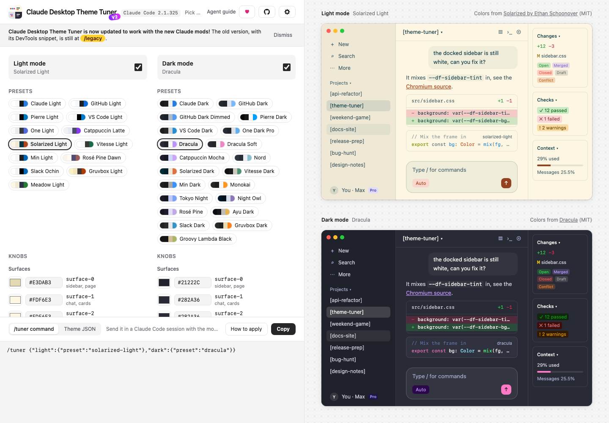

<p align="center">
  
</p>

<h1 align="center">Claude Desktop Theme Tuner V2</h1>

<p align="center">
  <a href="https://rinn7e.com/claude-desktop-theme-tuner/"><b>rinn7e.com/claude-desktop-theme-tuner</b></a>
</p>

<p align="center">
  Design a color theme for the Claude desktop app, in light and dark mode, and apply it with a Claude Code mod.
</p>

<p align="center">
  <a href="https://github.com/rinn7e/claude-desktop-theme-tuner/actions/workflows/pages.yml"></a>
  <a href="https://rinn7e.com/claude-desktop-theme-tuner/"></a>
  <a href="https://www.youtube.com/watch?v=DfnZwI23iNM"></a>
  <a href="https://github.com/sponsors/rinn7e"></a>
  <a href="LICENSE"></a>
</p>

Design a theme for the Claude desktop app with a live preview, and apply it
with the Theme Tuner mod of Claude Code: no DevTools, kept across restarts,
shown on mobile too. Light and dark mode each get their own theme, and the app
follows your OS between them. The first tuner, with its DevTools snippet, lives
on at [`/legacy`](https://rinn7e.com/claude-desktop-theme-tuner/legacy) (see
[Legacy](#legacy-the-first-tuner)).

**Open the app: [rinn7e.com/claude-desktop-theme-tuner](https://rinn7e.com/claude-desktop-theme-tuner/)**,
install the [Theme Tuner mod](#theme-claude-code-with-the-mod), or
[let your AI agent design a theme for you](#design-a-theme-with-an-ai-agent).

<p align="center">
  
</p>

## Features

- **Presets:** one for every code theme in the "Code appearance" setting of
  Claude, in the same order: Claude Light and Dark (the own colors of Claude),
  GitHub (Light, Dark, Dark Dimmed), Pierre, VS Code, One Light and One Dark
  Pro, Catppuccin Latte and Mocha, Solarized, Vitesse, Min, Rosé Pine and Rosé
  Pine Dawn, Slack Ochin and Slack Dark, Dracula and Dracula Soft, Nord,
  Monokai, Tokyo Night, Night Owl and Ayu Dark. Plus Gruvbox Light and Dark,
  Groovy Lambda Black and Meadow Light.
- **Every knob of a mod look:** per mode the four surfaces, the three texts,
  the five roles (accent, danger, success, warning, pro), the seven git colors
  and the code theme (or none, which leaves the picker of Claude free); for
  both modes more contrast and a backdrop (a color or a gradient). Each knob
  shows the value sent and where it comes from, and **Reset to** a preset
  takes a mode back.
- **A preview that draws what Claude draws:** the page runs the own
  `makeColors` of Claude and the graph of its design system, so the light and
  dark previews show the real tokens: a diff and pull request states for the
  git colors, status marks and a Pro chip for the roles, code in the colors
  of the code theme, the stronger borders of more contrast. Checked against
  probes of the real app: all 219 color tokens match.
- **Close to the first tuner:** the mod sends each preset so that Claude
  draws it as the first tuner did: the sidebar in the frame color, links and
  buttons in the accent, and the light sidebar compensated for the
  translucent macOS glass (on by default).
- **Readability:** the WCAG pairs of each mode, and what Claude itself says:
  a look Claude would refuse, and why.
- **Easy to apply:** copy the `/tuner` command (the default tab) or the
  **Theme JSON**; the settings menu saves and loads setup files and copies a
  share link. Edits are kept in your browser.
- **Made for AI agents:** an agent can write the setup itself and apply it
  through the mod; see
  [Design a theme with an AI agent](#design-a-theme-with-an-ai-agent).

## Theme Claude Code with the mod

Claude Code on desktop can be themed by a mod (a plugin with hooks), and the
Theme Tuner is one. It lives in [`package/claude-mod/`](package/claude-mod/),
and this repository is its marketplace.

Install it once. At the prompt of a terminal session:

```
/plugin install theme-tuner --marketplace rinn7e/claude-desktop-theme-tuner
```

In the desktop app: click **+** next to the prompt, then **Plugins**, **Add
marketplace** with `rinn7e/claude-desktop-theme-tuner`, then **Add plugin**.

Then, in a Claude Code session:

- `/tuner <JSON>` applies a setup from the home page (**Copy**, on the
  `/tuner command` tab).
- `/tuner solarized-light dracula` applies presets by id, and changes only
  the modes it names (`/tuner list` names them).
- `/tuner` opens the pane of the mod: a preset for each mode, the knobs it
  sends, a **Theme JSON** box that takes a setup, a link or preset ids, and
  **Turn off**.
- Or ask Claude ("make it Solarized with a magenta accent"): the mod gives it
  a `set_theme` tool that takes the setup JSON.
- `/tuner off` goes back to the own colors of Claude.

## Design a theme with an AI agent

In a Claude Code session with the mod, just ask: Claude writes the setup JSON
and applies it with the `set_theme` tool, so you see each change in the app
at once and ask for the next one.

Elsewhere, give the agent the link and say what you want:

```
Use https://rinn7e.com/claude-desktop-theme-tuner/ to design a theme based on
Solarized Light with neon magenta accents.
```

The agent finds the "Agent guide" link in the title bar and reads
[llms.txt](package/web-app/public/llms.txt): the setup JSON and its knobs,
the rules Claude checks, and a link (`#theme=...`) that opens the home with a
setup, for you to look at and apply.

## How a look is made

A mod look is not written token by token: `makeColors`
(`package/claude-mod/hooks/make-colors.js`, the own file of Claude) takes a
few anchors and role seeds, and Claude derives about 100 design system tokens
from them. The mod (`package/claude-mod/hooks/look.ts`) turns a preset into
those anchors and seeds, and checks with `makeColors` that Claude paints the
result. Every knob, the rules Claude checks and what was measured in the
real app are in [doc/mod-knobs.md](doc/mod-knobs.md); how the app was probed
is in [doc/claude-internals.md](doc/claude-internals.md).

| File                                           | Role                                                                                   |
| ---------------------------------------------- | -------------------------------------------------------------------------------------- |
| `package/claude-mod/hooks/look.ts`             | a setup to the look the mod sends, shared with the web app                             |
| `package/claude-mod/hooks/register.tsx`        | the `/tuner` command, the `set_theme` tool, the pane and the start of a session        |
| `package/web-app/src/screen/home-screen/`      | the home page: the knob editor, the code panel and preview v2                          |
| `package/web-app/src/theme/claude-graph.js`    | the graph and resolver of Claude, cut from `make-colors.js` by a snapshot test         |
| `package/web-app/src/theme/code-syntax.ts`     | the syntax colors of each code theme, generated by `pnpm --filter web-app code-syntax` |
| `package/web-app/snippets/mod-look.snippet.js` | for maintainers: reports which variables paint each part of the real app under a look  |

## Legacy: the first tuner

The first tuner lives on at
[`/legacy`](https://rinn7e.com/claude-desktop-theme-tuner/legacy): 13 colors
per mode with a live preview, copied as a DevTools snippet. It themes the
whole desktop app, not only Claude Code sessions. Tested against Claude
desktop 3.6556.2 on macOS (the version is shown in its title bar). The video
shows it:

[](https://www.youtube.com/watch?v=DfnZwI23iNM)

### Features of the first tuner

- **Tuning:** every color of a theme has a picker, with WCAG contrast checks
  for the text and accent pairs. Edits are kept in your browser.
- **Presets as files:** the gear menu saves both modes and the options to a
  JSON file and loads one back. Loaded names and links are cleaned, so a
  shared file cannot slip extra CSS into the snippet.
- **Share links:** **Copy Share Link** puts the setup in the link itself
  (`/legacy#theme=...`, which never reaches the server); opening it loads the
  theme.
- **Less GPU:** while Claude works, its looping animations (the shimmer on
  its working text above all) keep the GPU and the WindowServer of macOS
  busy, see
  [anthropics/claude-code#94003](https://github.com/anthropics/claude-code/issues/94003).
  The **Reduce motion** option switches on the own reduce-motion guard of
  Claude, which the app never sets; it roughly halved the GPU load in our
  test.
- **Thin arrows:** the **Thin arrows** option draws the own thin chevron of
  Claude in place of its filled triangle arrows, in the same `<style>`.
- **Readable output:** the snippet is shown in full before you copy it. It
  adds one `<style>` element and nothing else, and its CSS reads as plain CSS.

### The mod and the snippet

- The mod themes Claude Code sessions, in the desktop and mobile apps, and
  stays. The snippet themes the whole desktop app (the Chat tab and the full
  sidebar too) until Claude restarts, and alone has Thin arrows and Reduce
  motion.
- The snippet sets all 13 colors as they are; a mod look sends anchors and
  seeds, and Claude derives the rest (a selected row and the message bubble
  always come from the text color).

### Apply a theme with the snippet

The **How to apply** button of the first tuner walks through it, with a
screenshot of each step (in `package/web-app/src/asset/how-to-apply/`):

1. Turn on Developer Mode once: in Claude, **Help > Troubleshooting > Enable
   Developer Mode**.
2. Copy the theme snippet.
3. In Claude, choose **Developer > Show Dev Tools** (Option+Cmd+I).
4. In DevTools open **Sources**, click **>>** next to Page and Workspace, and
   choose **Snippets**, then **+ New snippet**.
5. Paste it, press Cmd+S to keep it, then Cmd+Enter to run it. The Console
   says `[theme] applied`.

The theme lasts until Claude restarts; after that, run the saved snippet
again. The **Revert** tab has the one-line command that removes it.

### Screenshots for an AI agent

An agent can design themes with the first tuner and show you screenshots: it
puts each theme in a link (`/legacy#theme=...`), and with `&view=preview` the
link shows only the themed preview of Claude, which the agent screenshots.
[llms.txt](package/web-app/public/llms.txt) explains it. Running the snippet
stays your step.

### When a Claude update breaks the theme

Updates rename or add color variables, and the surfaces using them go back to
stock. Maintainers run `package/web-app/snippets/diagnose.snippet.js` in the
Console the same way, with DevTools undocked (docked DevTools narrows the
window, which collapses the sidebar). It copies a JSON report to the
clipboard: what paints each area, the color variables in use, the rules
behind each sidebar, and every surface still white or gray. Map the new names
in `package/web-app/src/theme/tokens.ts`.

### How the snippet works

The UI of Claude takes its colors from CSS variables: the `--cds-*` of the
design system, the older `--bg-*` and `--text-*` of claude.ai (HSL triples),
and the `--df-*` of the Code tab frame. A theme is 13 semantic colors, and
everything else is derived from them.

| File                                               | Role                                                                                                                       |
| -------------------------------------------------- | -------------------------------------------------------------------------------------------------------------------------- |
| `package/web-app/src/theme/palette.ts`             | the semantic colors, their labels and the contrast pairs                                                                   |
| `package/web-app/src/theme/presets.ts`             | the hand-tuned presets, their order, and approximate stock colors for an unthemed mode                                     |
| `package/web-app/src/theme/code-themes.ts`         | the other code-theme presets, generated by `pnpm --filter web-app code-themes` (`package/web-app/scripts/code-themes.mjs`) |
| `package/web-app/src/theme/tokens.ts`              | maps a palette onto every Claude variable the snippet sets                                                                 |
| `package/web-app/src/theme/css.ts`                 | writes those variables under the light and dark selectors                                                                  |
| `package/web-app/src/theme/snippet.ts`             | wraps the CSS into the paste-able script                                                                                   |
| `package/web-app/src/preview/claude-mock.tsx`      | the preview, painted with the same variables (the home lays the tokens of Claude over them)                                |
| `package/web-app/src/storage/preset-file.ts`       | the preset JSON file: saving, and checking a loaded one                                                                    |
| `package/web-app/snippets/diagnose.snippet.js`     | for maintainers: reports the color variables of Claude after an update breaks the theme                                    |
| `package/web-app/snippets/stock-colors.snippet.js` | reads the own default colors of Claude, for the Claude presets                                                             |
| `package/web-app/snippets/arrows.snippet.js`       | lists every icon shape in Claude and where it shows, to find the bold arrows to restyle                                    |

Three quirks shape the CSS, each explained where it is handled in the code:

- Every declaration is `!important`, because Claude sets the same variables
  with selectors of up to five parts (its dark mode ones most of all).
- The frame re-sets its variables on its own sidebar and cards, so they are
  set there too.
- With macOS vibrancy the docked sidebar mixes a white tint over a
  transparent window, so the tint is set to the frame color at 100%.

## Development

A pnpm workspace: the web app is in `package/web-app`, the mod in
`package/claude-mod`. Node.js 24+ and pnpm, from the repository root:

```bash
pnpm install
pnpm run dev
```

Checks, from the root: `pnpm run check`, `pnpm run lint`,
`pnpm run format:check`, `pnpm run test`. The mod has its own, run by Claude
Code: `claude plugin validate package/claude-mod` and
`claude plugin test package/claude-mod`. Its presets
(`package/claude-mod/hooks/presets.ts`) are generated from the web app's: after changing a
preset, `pnpm test -u` writes them again. `package/claude-mod/hooks/make-colors.js` is
Claude's own, copied unchanged from the mod-authoring skill: copy it again
when Claude updates. `pnpm run build` writes a static site to `package/web-app/dist/`; every push
to `master` deploys it to GitHub Pages (`.github/workflows/pages.yml`). Follow the
[code convention](doc/code-convention.md). Open work is in the
[future plan](doc/future-plan.md).

## Support

Built by [rinn7e](https://github.com/rinn7e). If the tuner is useful to you,
you can help keep it going by
[sponsoring me on GitHub](https://github.com/sponsors/rinn7e).

## Credits and license

MIT, see [LICENSE](LICENSE). Overriding the app's own variables is the approach
of [Clay](https://github.com/maximebories/claude-desktop-clay-theme) by Maxime
Bories (MIT, see [LICENSE-clay](LICENSE-clay)). Each preset credits the color
scheme it follows, in `package/web-app/src/theme/presets.ts`, `package/web-app/src/theme/code-themes.ts` and
in the app. The code-theme presets are mapped from the VS Code themes Shiki
ships (all MIT); Pierre's are from `@pierre/theme` (Apache-2.0, see
[LICENSE-pierre](LICENSE-pierre)).
