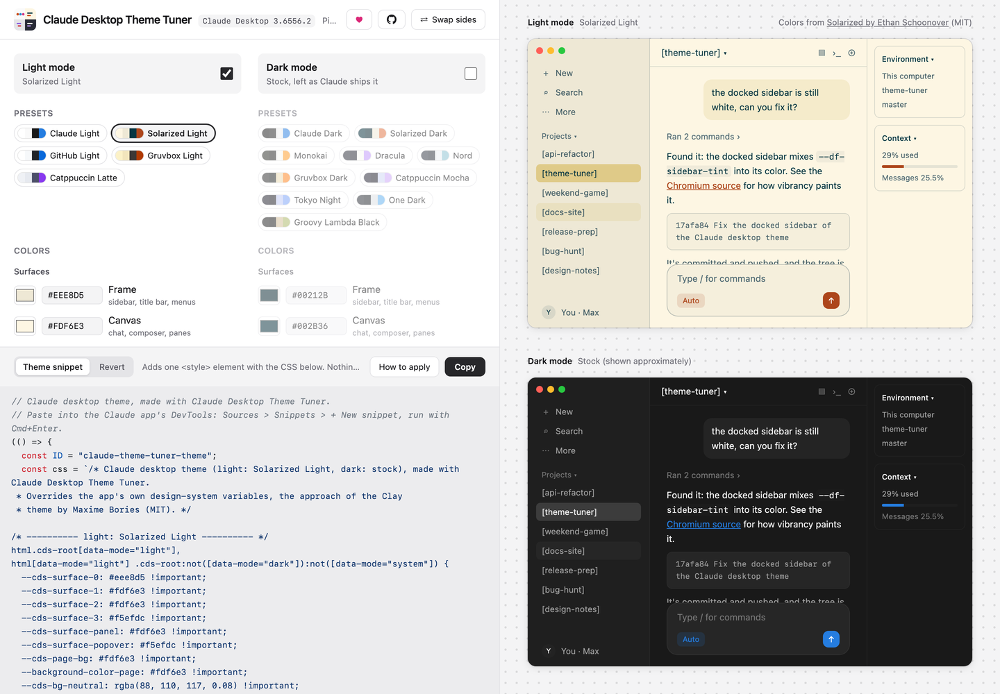

# Claude Desktop Theme Tuner

Pick a color theme for the Claude desktop app, tune its colors with a live
preview, and copy it as a DevTools snippet. Light and dark mode each get their
own theme, and the app follows your OS between them. Tested against Claude
desktop 3.6556.2 on macOS (the version is shown in the app's title bar).

**Open the app: [rinn7e.com/claude-desktop-theme-tuner](https://rinn7e.com/claude-desktop-theme-tuner/)**

<p align="center">
  
</p>

- **Presets:** Claude Light and Dark (Claude's own defaults, measured from the
  app, to change just one color), Solarized Light and Dark, GitHub Light,
  Gruvbox Light and Dark, Catppuccin Latte and Mocha, Monokai, Dracula, Nord,
  Tokyo Night, One Dark and Groovy Lambda Black.
- **Tuning:** every color of a theme has a picker, with WCAG contrast checks for
  the text and accent pairs. Edits are kept in your browser.
- **Preview:** mocks of the Claude app in light and dark mode at once, painted
  with the same variables the snippet sets.
- **Less GPU:** while Claude works, its looping animations (the shimmer on its
  working text above all) keep the GPU and macOS's WindowServer busy, see
  [anthropics/claude-code#94003](https://github.com/anthropics/claude-code/issues/94003).
  The **Reduce motion** option switches on Claude's own reduce-motion guard,
  which the app never sets; it roughly halved the GPU load in our test.
- **Readable output:** the snippet is shown in full before you copy it. It adds
  one `<style>` element and nothing else, and its CSS reads as plain CSS.

## Apply a theme

The app's **How to apply** button walks through it, with a screenshot of each
step (in `src/asset/how-to-apply/`):

1. Turn on Developer Mode once: in Claude, **Help > Troubleshooting > Enable
   Developer Mode**.
2. Copy the theme snippet.
3. In Claude, choose **Developer > Show Dev Tools** (Option+Cmd+I).
4. In DevTools open **Sources**, click **>>** next to Page and Workspace, and
   choose **Snippets**, then **+ New snippet**.
5. Paste it, press Cmd+S to keep it, then Cmd+Enter to run it. The Console
   says `[theme] applied`.

The theme lasts until Claude restarts; after that, run the saved snippet again.
The **Revert** tab has the one-line command that removes it.

## When a Claude update breaks the theme

Updates rename or add color variables, and the surfaces using them go back to
stock. Maintainers run `snippets/diagnose.snippet.js` in the Console the same
way, with DevTools undocked (docked DevTools narrows the window, which
collapses the sidebar). It copies a JSON report to the clipboard: what paints
each area, the color variables in use, the rules behind each sidebar, and
every surface still white or gray. Map the new names in `src/theme/tokens.ts`.
How Claude's UI is put together, and the traps met while debugging it, are in
[doc/claude-internals.md](doc/claude-internals.md).

## How it works

Claude's UI takes its colors from CSS variables: the design system's `--cds-*`,
claude.ai's older `--bg-*` and `--text-*` (HSL triples), and the Code tab
frame's `--df-*`. A theme is 13 semantic colors, and everything else is derived
from them.

| File                               | Role                                                                               |
| ---------------------------------- | ---------------------------------------------------------------------------------- |
| `src/theme/palette.ts`             | the semantic colors, their labels and the contrast pairs                           |
| `src/theme/presets.ts`             | the preset themes, and approximate stock colors for an unthemed mode               |
| `src/theme/tokens.ts`              | maps a palette onto every Claude variable the snippet sets                         |
| `src/theme/css.ts`                 | writes those variables under the light and dark selectors                          |
| `src/theme/snippet.ts`             | wraps the CSS into the paste-able script                                           |
| `src/preview/claude-mock.tsx`      | the preview, painted with the same variables                                       |
| `snippets/diagnose.snippet.js`     | for maintainers: reports Claude's color variables after an update breaks the theme |
| `snippets/stock-colors.snippet.js` | reads Claude's own default colors, for the Claude presets                          |

Three quirks shape the CSS, each explained where it is handled in the code:

- Every declaration is `!important`, because Claude sets the same variables
  with selectors of up to five parts (its dark mode ones most of all).
- The frame re-sets its variables on its own sidebar and cards, so they are set
  there too.
- With macOS vibrancy the docked sidebar mixes a white tint over a transparent
  window, so the tint is set to the frame color at 100%.

## Development

Node.js 24+ and pnpm:

```bash
pnpm install
pnpm run dev
```

Checks: `pnpm run check`, `pnpm run lint`, `pnpm run format:check`,
`pnpm run test`. `pnpm run build` writes a static site to `dist/`; every push
to `main` deploys it to GitHub Pages (`.github/workflows/pages.yml`). Follow the
[code convention](doc/code-convention.md). Open work is in the
[future plan](doc/future-plan.md).

## Support

Built by [rinn7e](https://github.com/rinn7e). If the tuner is useful to you,
you can help keep it going by
[sponsoring me on GitHub](https://github.com/sponsors/rinn7e).

## Credits and license

MIT, see [LICENSE](LICENSE). Overriding the app's own variables is the approach
of [Clay](https://github.com/maximebories/claude-desktop-clay-theme) by Maxime
Bories (MIT, see [LICENSE-clay](LICENSE-clay)). Each preset credits the color
scheme it follows, in `src/theme/presets.ts` and in the app.
